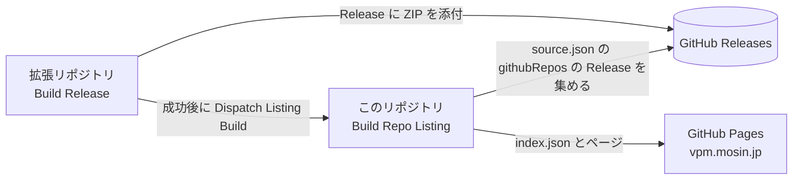

# ryoctrl VPM（公開 VPM の一覧）

VCC（VRChat Creator Companion）と ALCOM で使う公開 VPM（VRChat Package Manager）の一覧 `https://vpm.mosin.jp/index.json` を作るリポジトリです。
VRChat 公式の雛形 [vrchat-community/template-package-listing](https://github.com/vrchat-community/template-package-listing) から作りました。

## 使う人へ

VCC または ALCOM の「Add Repository」に `https://vpm.mosin.jp/index.json` を入れると、下の拡張をプロジェクトに追加できます。

| 拡張 | パッケージ ID | リポジトリ |
|---|---|---|
| Avatar Recolor（色改変ツール） | `jp.mosin.avatar-recolor` | [ryoctrl/AvatarRecolor](https://github.com/ryoctrl/AvatarRecolor) |
| Outfit Bone Sync（衣装のボーン合わせ） | `jp.mosin.outfit-bone-sync` | [ryoctrl/OutfitBoneSync](https://github.com/ryoctrl/OutfitBoneSync) |

## 仕組み



- `source.json`: 一覧の名前・id（`jp.mosin.vpm.public`）・URL と、載せる拡張リポジトリ（`githubRepos`）。
- `.github/workflows/build-listing.yml`: 雛形の Build Repo Listing。`githubRepos` の各リポジトリの Release にある ZIP を集めて `index.json` と一覧のページを作り、GitHub Pages に配ります。`source.json` を main に push したとき、手動で実行したとき、拡張リポジトリの Dispatch Listing Build から起動されたときに動きます。雛形から変えたのは配備の部分だけで、配備の前に 15 秒待ち、失敗したら 60 秒待ってもう一度配備します（下の「一覧の作り直し方」の既知の問題への対策）。
- `Website/`: 一覧のページの雛形（雛形のまま）。
- GitHub Pages: Settings → Pages の Source は GitHub Actions、独自ドメインは `vpm.mosin.jp`。

## 一覧の作り直し方

- 自動: 拡張リポジトリで Build Release が成功すると、その拡張リポジトリの Dispatch Listing Build が、このリポジトリの Build Repo Listing を起動します。
- 手動: `gh workflow run build-listing.yml -R ryoctrl/vpm-listing`（または Actions → Build Repo Listing → Run workflow）。
- 確認: `gh run list -R ryoctrl/vpm-listing --limit 3` で結果を見て、`curl -s https://vpm.mosin.jp/index.json` に新しい版が載っていることを確かめます。

Deploy to GitHub Pages は「No artifacts named "github-pages" were found」で失敗することがあります。GitHub 側の既知の問題（[actions/deploy-pages#451](https://github.com/actions/deploy-pages/issues/451)）です。Workflow が 1 回だけ自動でやり直しますが、それでも失敗したときは、同じ実行の Re-run ではなく（成果物が 2 つになって必ず失敗する）、手動で新しく実行し直してください。

## 一覧を作り直すトークン

拡張リポジトリの Dispatch Listing Build は、Secret `LISTING_DISPATCH_TOKEN` のトークンでこのリポジトリの Workflow を起動します。このリポジトリの Actions だけを操作できるトークンにします。

1. GitHub の Settings → Developer settings → Personal access tokens → **Fine-grained tokens** → **Generate new token**。
   - Repository access: **Only select repositories** → `ryoctrl/vpm-listing` だけを選ぶ。
   - Permissions → Repository permissions → **Actions: Read and write** だけを設定する（Metadata: Read-only は自動で付く）。
2. 拡張リポジトリごとに登録する（値は入力を求められたら貼り付ける）。

   ```powershell
   gh secret set LISTING_DISPATCH_TOKEN -R ryoctrl/<拡張リポジトリ名>
   ```

3. 期限が切れたら、同じ画面で Regenerate token し、`source.json` の `githubRepos` にあるすべての拡張リポジトリへ登録し直します。期限切れのあいだは Dispatch Listing Build が失敗しますが、Release は公開済みなので、手動で一覧を作り直せば載ります。

## 拡張を追加する手順

拡張は Rurune_Nadema の `Assets/9.Tools/<フォルダ名>/` にあり、Git 管理されていません。作業場所は `C:\Users\mosin\projects\vrc-packages\` です。購入アセット（自作でないもの）は公開リポジトリに入れません。

### 1. 名前を決める

- パッケージ ID: `jp.mosin.<ケバブケースの名前>`（例: `jp.mosin.outfit-bone-sync`）
- リポジトリ: `ryoctrl/<フォルダ名>`（公開）
- ライセンス: MIT。作者名・著作権者は `ryoctrl`

### 2. リポジトリを作る

```powershell
cd C:\Users\mosin\projects\vrc-packages
gh repo create ryoctrl/<名前> --public --template vrchat-community/template-package --description "<説明>"
gh repo clone ryoctrl/<名前>
```

クローンした中で、雛形を整えます。

- `git rm -r Packages/com.vrchat.demo-template .github/workflows/build-listing.yml Website`（拡張ごとの一覧はこのリポジトリと重なるので消す）
- `Packages/.gitignore` の `!com.vrchat.demo-template` を `!jp.mosin.<名前>` に変える
- 既存の拡張リポジトリ（例: AvatarRecolor）から `LICENSE` と `.github/workflows/dispatch-listing.yml` をコピーする
- `README.md` を、AvatarRecolor の README と同じ構成（導入・構成・版の公開・設定・ライセンス）で書き換える

### 3. 拡張を移す

1. Rurune_Nadema を開いている Unity を閉じる。
2. 控えを取る: `Assets/9.Tools/<フォルダ名>` とその `.meta` を `C:\Users\mosin\projects\vrc-packages\_backup\<日付>-<フォルダ名>\` にコピーする。
3. `Assets/9.Tools/<フォルダ名>/` の中身を `.meta` ごと `Packages/jp.mosin.<名前>/` へ**移動**する。コピーして元を残すと GUID が重複するので、元は残さない。フォルダ自体の `<フォルダ名>.meta` は使わないので消す（控えには残る）。
4. パッケージの中を整える。
   - 利用規約の `LICENSE.txt`（と `.meta`）を消し、MIT の `LICENSE.md` を置く。README の利用条件の行を MIT に、導入の節を VPM での追加に書き換え、unitypackage を手で書き出す配布手順の節は消す。作者名は `ryoctrl` 以外を書かない。
   - `Assets/9.Tools/...` を前提にしたパス（`Application.dataPath` + `"9.Tools/..."` など）を `Packages/jp.mosin.<名前>/...` に直す。コメントに書いた置き場所も直す。
   - asmdef がない拡張には asmdef を作る（パッケージの中のスクリプトは asmdef に入れる。エディター専用なら `includePlatforms` を `["Editor"]` にする）。
   - `package.json` を作る。VCC が必須とするのは `name` / `version` / `displayName` / `author`。ほかに `unity`（`2022.3`）・`description`・`license`（`MIT`）・`licensesUrl`・`documentationUrl`・`changelogUrl`・`vpmDependencies` を入れる（AvatarRecolor・OutfitBoneSync の `package.json` を参考にする）。VRChat SDK を使う拡張は `vpmDependencies` に `com.vrchat.avatars` を書く。
5. Rurune_Nadema の `Packages/manifest.json` の `dependencies` に次の行を足す。

   ```json
   "jp.mosin.<名前>": "file:C:/Users/mosin/projects/vrc-packages/<リポジトリ名>/Packages/jp.mosin.<名前>"
   ```

6. Unity で Rurune_Nadema を開き、コンパイルエラーがないこと、アバターに付けた部品が Missing Script になっていないことを確かめる。画面を出さずに確かめるときは次のコマンドで、終了コードが 0 で、ログに `error CS` がないことを見る。

   ```powershell
   & "C:\Program Files\Unity\Hub\Editor\2022.3.22f1\Editor\Unity.exe" -batchmode -quit -projectPath "C:\Users\mosin\Documents\VRChatCreatorCompanion\VRChatProjects\Rurune_Nadema" -logFile "$env:TEMP\rurune-batch.log"
   ```

   Unity が新しく作った `.meta`（`package.json.meta`・`LICENSE.md.meta` など）もコミットに含める。

### 4. 公開する

1. 公開してよい内容か（作者名が `ryoctrl` だけか、秘密値がないか）を確かめてから、main にコミットして push する。
2. リポジトリの設定をする。

   ```powershell
   gh variable set PACKAGE_NAME -R ryoctrl/<名前> --body jp.mosin.<名前>
   gh secret set LISTING_DISPATCH_TOKEN -R ryoctrl/<名前>
   ```

3. 最初の版を公開する: `gh workflow run release.yml -R ryoctrl/<名前>`。`package.json` の `version` のタグと Release ができます。
4. Release ができてから、このリポジトリの `source.json` の `githubRepos` に `ryoctrl/<名前>` を足して main に push する（Build Repo Listing が動く）。Release が 1 つもないリポジトリを載せると、Build Repo Listing が `ArgumentNullException` で失敗するので、順番を守る。
5. `curl -s https://vpm.mosin.jp/index.json` に載ったことを確かめ、この README の表に拡張を足す。

2 つ目以降の版は、拡張リポジトリの README の「版の公開」の手順だけで一覧まで更新されます。

## 拡張を更新するとき（Rurune_Nadema で確かめながら）

Rurune_Nadema は `manifest.json` の `file:` 参照で、各拡張リポジトリの `Packages/jp.mosin.<名前>/` をそのまま読み込んでいます。これまでどおり Rurune_Nadema で使いながら直せます。

1. Unity の Project ウィンドウでは、拡張は `Assets/9.Tools` ではなく **Packages** の下に表示名（例: Outfit Bone Sync（衣装のボーン合わせ））で出ます。ここでのスクリプトの編集・ファイルの追加は、拡張リポジトリの作業ツリー（`C:\Users\mosin\projects\vrc-packages\<リポジトリ名>\Packages\jp.mosin.<名前>\`）に直接入り、保存すると Unity が再コンパイルします。Codex・エディターからそのフォルダを直接編集しても同じです。
2. 試すためのシーン・アバター・衣装は Rurune_Nadema の `Assets` に置き、パッケージの中には入れません（パッケージの中身はそのまま公開されます）。
3. 区切りがついたら、拡張リポジトリでコミットして push します。Unity が新しく作った `.meta` も含めます。
4. 公開するときは `package.json` の `version` を上げてから push し、拡張リポジトリの Build Release を実行します（一覧は自動で更新されます）。公開しない変更は push だけでかまいません。

## Rurune_Nadema での注意

- Rurune_Nadema には、公開 VPM から同じパッケージを入れない。`manifest.json` の `file:` 参照と二重になります。
- `manifest.json` の `file:` の行は、vrc-get（ALCOM と同じ中身の CLI。1.9.2 で確認）でほかのパッケージを downgrade・upgrade・resolve しても残りました（2026-11-24、試験用のプロジェクトで確認）。
- Codex から編集できるよう、`%USERPROFILE%\.codex\config.toml` の `[sandbox_workspace_write]` の `writable_roots` に `C:\Users\mosin\projects\vrc-packages` を入れてあります。拡張を増やしても追加の設定はいりません。
